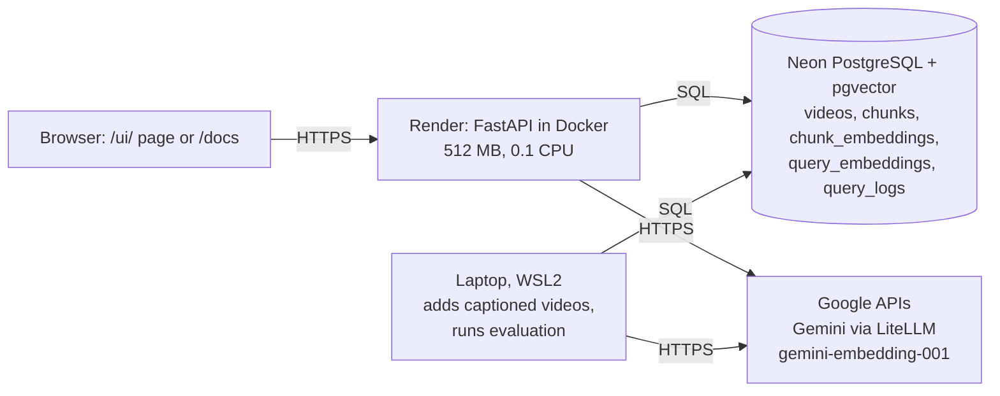

# YouTube Deep-Dive

Ask a question about a YouTube video and get an answer built only from what was said in it, where every claim links to the moment in the video it came from.

It is a retrieval-augmented generation (RAG) system over YouTube transcripts: the transcript is split into chunks, the chunks closest in meaning to the question are given to a language model, and the model may cite them only by number. The code, not the model, turns each number into a timestamp link, so a timestamp cannot be invented.

B.Tech minor project, USICT, GGSIPU (Arnav Soni, 2026).

- **Live page:** https://youtube-deepdive.onrender.com/ui/ (the `/ui/` page is live only after the November deploy; before that, use https://youtube-deepdive.onrender.com/docs)
- **API docs:** https://youtube-deepdive.onrender.com/docs

The server runs on Render's free tier and sleeps after 15 idle minutes, so the first request after a quiet period takes about 40 seconds.

## What it does

- Lists the videos that have been added, with thumbnails and titles.
- Answers one question at a time about one video, from that video's transcript only, with numbered citations that open the video at the cited moment.
- Lets anyone add a video by pasting the transcript YouTube shows under it (with limits; see below). Captioned videos are also added from the laptop.
- Logs every request, failures included, with the model used, the chunks retrieved, tokens, latency, estimated cost and any error.

It is single-turn: each question is answered on its own, with no memory of earlier questions.

## Architecture



YouTube blocks transcript requests from Render's servers, so the live server never fetches captions. Captioned videos are added from the laptop into the same database; visitors add videos by pasting a transcript.

## How a question flows

`POST /ask` with `{"video": "<url or id>", "question": "..."}`:

1. **Check the video** (`app/main.py`, `ask`). The id is parsed by `app/youtube.py` `extract_video_id`; a bad link is 400. A video that was never added, or is hidden, is 404.
2. **Embed the question** (`app/embeddings.py`, `embed_query`): from the `query_embeddings` cache if the same text was seen before, otherwise one call to gemini-embedding-001 (768 dimensions) with a 10-second timeout.
3. **Retrieve** (`app/retrieval.py`, `dense_search`): the 5 chunks of that video closest to the question by pgvector's cosine distance (`<=>`). If dense search cannot run, `main._retrieve` falls back to word search (`search`) and logs `lexical_fallback:<reason>`.
4. **Build the prompt** (`app/generation.py`, `build_context` and `render_prompt`): the chunks become excerpts `[1]` to `[5]`, with no times and no ids, and the template `app/prompts/answer_v1.txt` is filled in a single pass.
5. **Generate** (`generate`): LiteLLM calls `gemini/gemini-3.6-flash` at temperature 0; if it fails, the backup in `FALLBACK_MODELS` answers. `generate` never raises; a failure becomes an error field and a 502.
6. **Check citations** (`invalid_citations`, using `app/citations.py` `cited_numbers`): any `[n]` outside 1 to 5 is recorded as `invalid_citations`.
7. **Build links** (`ask`): each valid `[n]` maps to its chunk and becomes `https://youtu.be/<id>?t=<start>`.
8. **Log** (`_write_log`): exactly one `query_logs` row, written in a `finally` block on every path.

## Results

From the final evaluation on 18 Nov 2026. Every number is in `evaluation/REPORT_DATA.md` with the file and command it came from.

**Retrieval, human-labelled** (`evaluation/golden_set.yaml`, 14 questions on 4 reported videos, top 5, `evaluation/results/retrieval_human.txt`):

| | Word search | Dense (live) | Hybrid (RRF) |
|---|---|---|---|
| Recall@5 | 0.857 (12/14) | 1.000 (14/14) | 1.000 (14/14) |
| MRR | 0.631 | 0.917 | 0.815 |
| Recall@1 | 7/14 | 12/14 | 10/14 |

**Retrieval, AI-written questions** (`evaluation/golden_set_agent.yaml`, written and checked by Claude Code, not by Arnav; 18 reported videos; `evaluation/results/retrieval_agent.txt`):

| Question type | Word search | Dense | Hybrid |
|---|---|---|---|
| Uses the speaker's own words (18) | 18/18, MRR 0.963 | 18/18, MRR 1.000 | 18/18, MRR 0.972 |
| Paraphrase, avoids the speaker's words (18) | 7/18, MRR 0.292 | 18/18, MRR 0.972 | 15/18, MRR 0.604 |

**Grounding, AI-labelled** (an AI judge, Claude Code, labelled every answer with the rubric in `docs/grounding.md`; `evaluation/grounding_labels_agent.yaml`, `evaluation/results/summary.txt`). The run's answers came through the real `/ask` code on the dev branch; the backup model answered all of them because the main model was returning 503:

| Answers (this run) | Segments supported | Every segment supported | Refusals |
|---|---|---|---|
| 19 human questions | 31/31 | 18/18 answered | 1 false refusal ("how to be consistent") |
| 40 AI-written questions | 33/35 | 18/20 answered | 19 of 19 negatives refused correctly, 0 missed, 1 false refusal |

**Grounding, Arnav's labels:** 1 scored answer so far (3/3 segments supported). Agreement with the AI judge exists on only 2 answers, far too few to trust; a 20-segment spot check is prepared (`evaluation/spot_check_labels.yaml`).

**Citation rate** (proposal: at least 90% of responses cite timestamps; `evaluation/results/citation_rate.txt`): earlier answers on the dev branch 40/43 (93.0%). In this run 39/59 (66.1%) overall, because 19 questions were built to be unanswerable and a correct refusal cites nothing; 38/38 (100%) of the answers that were not refusals.

Not measured yet: production latency (P50, P95) and the production citation rate. The scripts are written (`evaluation/export_logs.py`, `evaluation/live_latency.py`, `evaluation/log_stats.py`); laptop numbers are never used in their place.

## Running it locally

Inside WSL (Ubuntu), with Python 3.12. Keep the code in the Linux file system (for example `~/code/deepdive`), not under `/mnt/c`.

```bash
git clone https://github.com/Arnav-77/youtube-deepdive.git ~/code/deepdive
cd ~/code/deepdive
python3.12 -m venv .venv
source .venv/bin/activate
pip install -r requirements-dev.txt
cp .env.example .env
```

Edit `.env`. `DATABASE_URL` (a Neon Postgres URL; use a dev branch, never production) and `GEMINI_API_KEY` are required; every other setting the app reads is listed in `.env.example` with a comment. Keep the `postgresql+psycopg://` prefix: plain `postgresql://` makes SQLAlchemy look for psycopg2, which is not installed.

Create the tables, then start the server:

```bash
alembic upgrade head
python run.py
```

It serves on port 8000 (or `$PORT`): the page at http://localhost:8000/ui/ and the API docs at http://localhost:8000/docs.

With Docker, and the same limits as Render:

```bash
docker build -t deepdive .
docker run --env-file .env -p 8000:8000 --cpus=0.1 --memory=512m deepdive
```

## Endpoints

| Method | Path | Purpose |
|---|---|---|
| GET | `/health` | Liveness; touches nothing external; returns the deployed commit. |
| GET | `/ready` | Readiness; checks the database. |
| GET | `/ui/` | The web page. |
| GET | `/videos` | Added videos, newest first, with `added_by` and `checked`. Hidden videos are left out. |
| GET | `/videos/{id}` | Progress for one video: `ready`, `embedding`, `incomplete` or `not_found`, with chunk counts. |
| POST | `/ask` | Ask about an added video. 404 if not added, 502 if the model fails. |
| POST | `/videos/paste` | Add a video from a pasted transcript (public, limited). |
| POST | `/videos` | Add a captioned video. Admin only (`X-Paste-Token`); fails closed. |

## Public paste rules

`POST /videos/paste` with JSON `{"url": "...", "transcript": "..."}`, where the transcript is copied from YouTube's "Show transcript" panel. Both real panel layouts seen so far are parsed (time labels glued to the text, and times on their own lines).

- **Limits for visitors:** at most 150 chunks per paste (422 above that) and 600 visitor chunks per rolling 24 hours across all visitors, counted from the database (429 when reached). `PUBLIC_PASTE_DAILY_CHUNKS` changes the daily cap.
- **Admin token:** a request with the right `X-Paste-Token` header (`PASTE_TOKEN`) skips both limits. A wrong token gets 401. `POST /videos` requires the token and fails closed when none is configured.
- **"not checked":** videos added by visitors are labelled "not checked" on the page, because nobody has verified that the pasted text is the video's real transcript.
- **Repeats and hiding:** pasting a video that already exists gets 409. Chunks are append-only and never edited or deleted. `HIDDEN_VIDEO_IDS` hides a video from the list and from `/ask` (404) without deleting anything.
- Embedding runs in the background: the request answers 202 while it runs and 200 when the video is ready; sending the same request again resumes an interrupted embedding.

## Tests

```bash
source .venv/bin/activate
pytest
```

The suite runs offline: `tests/conftest.py` disables `.env`, replaces `DATABASE_URL` with an address that cannot connect, removes the API key and blocks Python sockets. Evaluation scripts are checked by reading their source, never by running them. Tests marked `xfail(strict=True)` document known bugs; when a bug is fixed its test fails until the marker is removed. GitHub Actions runs the suite on every push and pull request (`.github/workflows/tests.yml`).

## Evaluation in one command

```bash
python evaluation/run_all.py --json evaluation/results/summary.json > evaluation/results/summary.txt
```

It makes no API calls. It runs retrieval for dense, lexical and hybrid search on both question sets from cached question embeddings (and stops with a message if one is missing), then scores grounding from Arnav's labels and from the AI labels separately, and prints one summary table. It reads only the dev branch (`evaluation/dev_guard.py` stops it anywhere else).

Other evaluation tools, all in `evaluation/`:

- `run_eval.py --golden FILE --method M --set reported|dev`: retrieval for one method. Always pass `--method` and `--set`.
- `score_grounding.py [--labels FILE] [--golden FILE ...] [--compare FILE]`: grounding rate, answer-level rate, refusal results, agreement. Rules: `docs/grounding.md`.
- `generate_answers.py`: answers through the real `/ask` code on the dev branch, with a call budget.
- `export_logs.py`, `log_stats.py`, `citation_rate.py`, `live_latency.py`: request-log numbers (export first, then compute from the CSV).
- `spot_check.py`, `spot_check_agreement.py`: a hand check of 20 AI-labelled segments.

## Known limitations and what is not built

- **Not built:** the runtime critic that would block unsupported answers before display (an offline rubric and scorer exist instead); follow-up questions (multi-turn); topic-shift chunking (the fixed-size baseline is measured); a cross-encoder reranker; Whisper transcription for videos without captions; cross-video synthesis; a Groq fallback (the backup is a second Gemini model); the Next.js frontend (one static page instead).
- **Each model attempt is capped at 45 seconds** (`MODEL_TIMEOUT_S` in `app/generation.py`), so the main model plus one backup take at most 90 seconds before `/ask` answers 502. Before 19 Nov 2026 there was no timeout and one hung call held a request for about five minutes (`tests/test_known_bugs.py` now tests the fix).
- **A refusal is logged as an answered request**; only a label tells them apart.
- **Citations point to a whole chunk** (about 1,000 characters), so a link can start up to a minute before the claim.
- **Model names are not checked at startup**, so a wrong name fails on the first question.
- **The live server cannot fetch captions** (YouTube blocks Render's IP).
- **Answers are not reproducible**, even at temperature 0; repeated runs differ.
- **English only**, and the benchmark leans towards machine-learning explainers and lectures.
- **Grounding numbers rest mostly on an AI judge**; Arnav's own labels cover only a few answers so far.

More detail: `docs/decisions.md` (design decisions with alternatives), `docs/problems.md` (what broke and how it was found), `docs/grounding.md` (the grounding rubric).

## Licence

MIT. See `LICENSE`.
